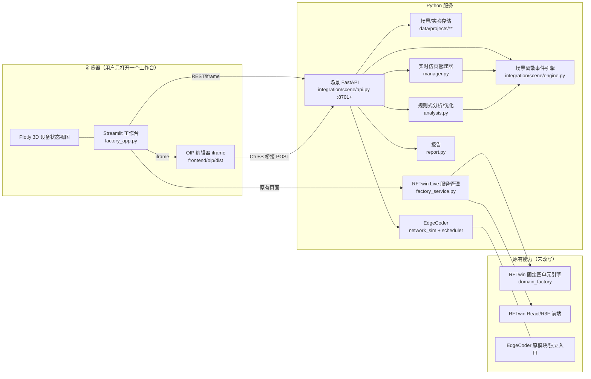
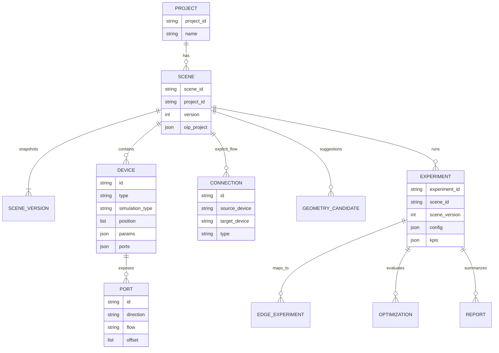
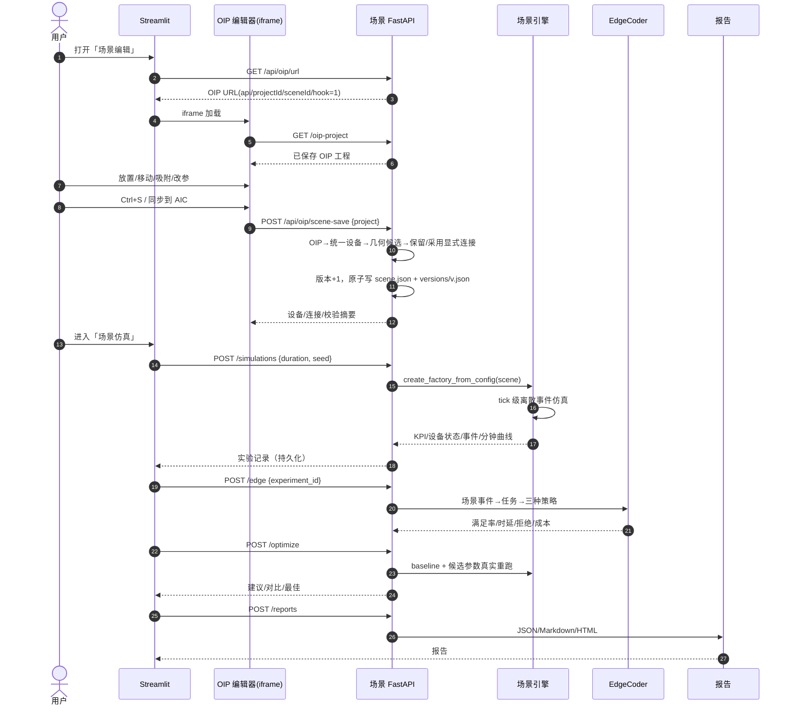
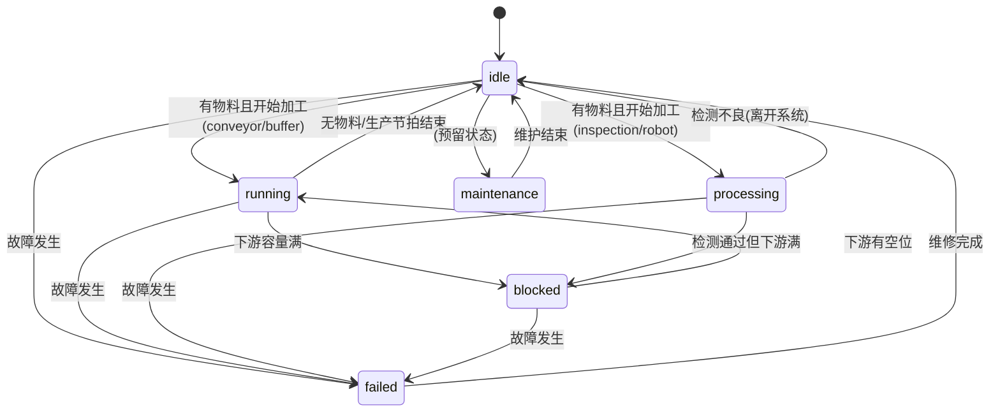
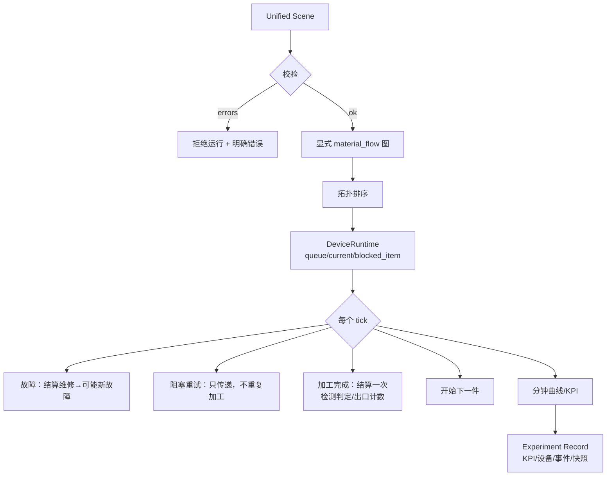
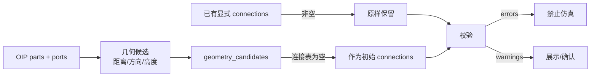
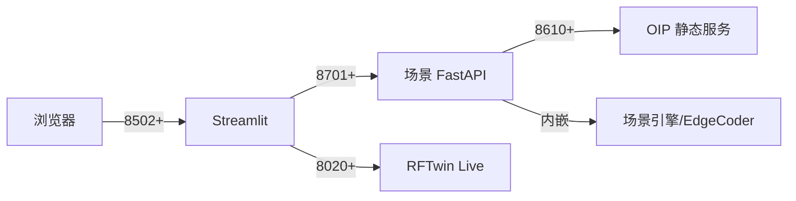
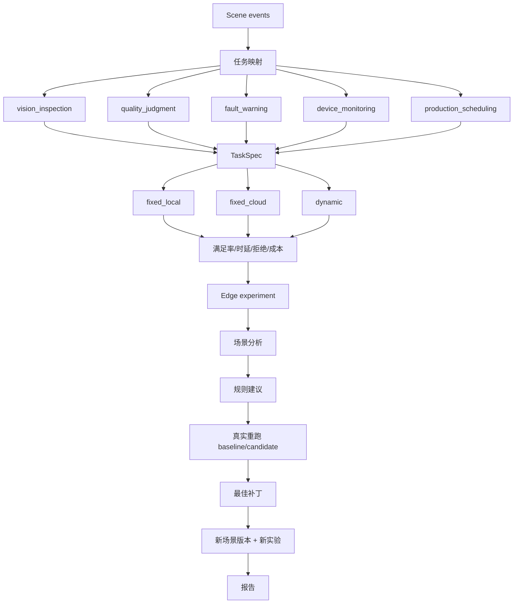

# AIC Factory Studio 集成架构

> OIP 三维场景编辑 → 统一设备模型 → Python 离散事件仿真 → EdgeCoder → 分析与报告
>
> 图中所有 KPI/调度/网络数值均来自软件仿真，不是真实工厂或 6G 实测。

---

## 1. 系统总览



RFTwin 固定四单元产线仍走原来的 `build_factory_params → FactoryEngine`；自建场景走新的
`SceneFactoryEngine`。两者共享项目/实验存储，但引擎与数据模型隔离。

---

## 2. 统一数据模型



关键字段：

- `Device`：`id/type/name/position/rotation/dimensions/params/simulation_type/ports/metadata`
- `Port`：`id/direction(input/output)/flow(material)/offset/out`
- `Connection`：`source_device/source_port/target_device/target_port/connection_type`
- `SceneDocument`：`devices/connections/geometry_candidates/validation/simulation_settings/oip_project`

设备 ID 使用 OIP `part.id`，场景版本/实验快照保证可追溯。

---

## 3. 数据流（主编排链）



---

## 4. 仿真状态机



设备状态每次快照带 `timestamp` 与 `sim_time_sec`；三维视图按真实状态着色。

---

## 5. 仿真引擎数据流



确定性约束：

- 固定 `tick_sec`、单一 `random.Random(seed)`；
- 相同场景 + 相同 seed + 相同时长 ⇒ 相同 KPI；
- 实时仿真由 wall-clock 推进，不作为可复现实验权威。

---

## 6. 连接与校验



- 空间吸附 ≠ 生产流程；移动设备只产生 `connection_geometry_mismatch` warning。
- 删除设备后旧连接保留并报 `missing_*_device`，不会静默重连。
- 重新推导/采用候选必须由 API/UI 显式触发。

---

## 7. 持久化布局

```text
data/projects/<project_id>/
├─ project.json                      # 原有项目（RFTwin 参数等）
├─ experiments/<experiment_id>.json  # 工厂/边缘/优化/实时实验
└─ scenes/<scene_id>/
   ├─ scene.json                     # 当前统一场景（OIP 存哈希引用，不含整份工程）
   ├─ summary.json                   # 列表用轻量摘要（设备数/版本/校验计数）
   ├─ oip/<hash>.json                # OIP 工程，按内容寻址，相同工程只存一份
   ├─ versions/0001.json ...         # 不可变版本（同样只存 OIP 哈希引用）
   └─ reports/<report_id>.{json,md,html}
```

`load_scene()` 会按 `oip_blob` 自动从 `oip/` 读回工程；旧格式（工程内联在
`scene.json`/版本文件）仍可直接读取，可用 `tools/compact_scene_storage.py` 迁移。

- 所有 JSON 使用临时文件 + `os.replace` 原子写；
- 场景写入在 API 进程内加可重入锁；多 API 实例未做分布式锁；
- 实验保存 `config.scene_snapshot`、`scene_id`、`scene_version`，后续场景变化不影响历史实验。

---

## 8. 服务与端口



| 服务 | 默认 | 启动 |
|---|---|---|
| Streamlit | 8502–8529 | `run_platform.py`（前台） |
| 场景 API | 8701+ | `run_platform.py` 自动 |
| OIP | 8610+ | 场景编辑页按需（Python http.server） |
| RFTwin Live | 8020+ | 原三维仿真页按需 |

健康检查：`/api/health`（场景 API）、`/app/`（OIP）、`/api/health`（RFTwin）。
运行时状态：`data/runtime/{scene_api,oip_service,service}.json`；`stop_platform.py` 统一停止。

---

## 9. EdgeCoder 与 AI 分析



分析只引用实验记录中的真实指标；候选评估必须重跑；应用优化会生成新版本并保留旧实验。

---

## 10. 核心不变量

1. Python 场景/仿真引擎是生产 KPI 的唯一权威；OIP 不做生产仿真。
2. 设备 ID 跨导入稳定；场景版本不可变；实验引用版本与参数快照。
3. 显式 `connections` 与几何候选分离；移动不自动改业务流。
4. 未映射设备显式标记 display_only；参与物料流即报错。
5. 所有 KPI 来自 tick 级仿真，不写死、不伪造；实时与离线实验明确区分。
6. RFTwin/EdgeCoder 核心代码零改动；原有四单元产线与测试保留。
7. 所有服务只监听 127.0.0.1；日志/状态/数据均可追溯。
