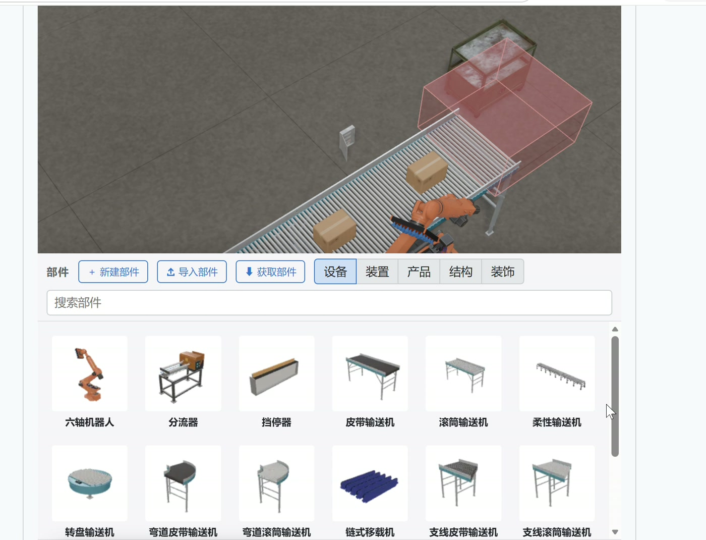
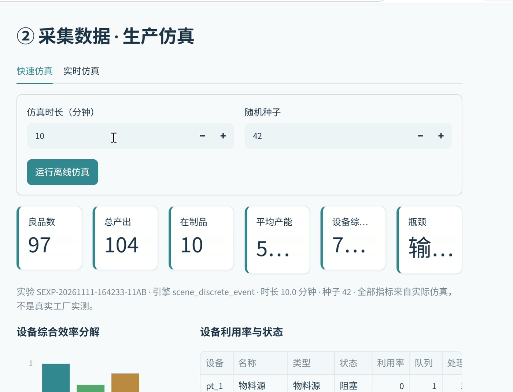

# AIC Factory Studio · 数字工厂仿真平台

在浏览器里搭建一条虚拟产线，先试跑，再判断设备和计算资源该怎样调整。

如果把输送带调快，产量一定会增加吗？质检任务变多，电脑会不会忙不过来？AIC Factory Studio 将三维建模、生产仿真和计算任务分配放在同一工作台，帮助使用者观察设备瓶颈、比较方案并回查实验。

**当前版本：1.1.1 · Windows 本地 Web 平台 · 中文界面**

[下载安装包](https://github.com/day-dreamer-11/3d-/releases/latest) · [使用说明](docs/使用说明.md) · [技术架构](ARCHITECTURE.md) · [第三方组件](THIRD_PARTY_NOTICES.md)



## 能做什么

- 用中文部件库布置输送机、机器人和检测工位，保存场景或另存为新方案。
- 调整设备参数，模拟物料流转，查看良品数、在制品、产能和设备状态。
- 将质检等生产事件转成计算任务，比较本地、边缘和云端分配的按时完成情况。
- 固定时长和随机种子进行实验对照，保存参数与结果，导出报告。
- 安装后直接打开预置视频案例，不必从空白产线开始。

所有生产和网络指标均来自软件仿真。当前没有接入 6G 实网，主流程不运行真实视觉识别模型；任务分配使用可解释的在线规则评分，不是训练得到的模型。真实工厂收益需要进一步验证。

## 普通用户：下载安装版

1. 从 [Releases](https://github.com/day-dreamer-11/3d-/releases/latest) 下载 `AIIndustrialFactory-Setup-1.1.1.exe`。
2. 双击安装，完成页保留“在默认浏览器打开 AI 数字工厂”。
3. 点击完成后耐心等待，平台准备就绪会自动打开浏览器。以后从开始菜单启动“AI 数字工厂”。
4. 选择预置演示案例，点击“一键演示”，再进入工作台查看结果。

安装版包含 Python、前端资源和演示数据，核心演示可离线运行。桌面快捷方式为可选项。关闭浏览器不会停止后台服务；可通过开始菜单“停止 AI 数字工厂”退出。详细步骤见[使用说明](docs/使用说明.md)。

## 开发者：从源码运行

需要 Git、Python 3.12 或 3.13、Node.js 24 或更高版本。首次安装依赖需要联网。下面以 Windows PowerShell 为例：

```powershell
git clone https://github.com/day-dreamer-11/3d-.git
cd 3d-
python -m venv .venv
.\.venv\Scripts\python.exe -m pip install -r requirements.txt

# 编译主界面的三维编辑器
npm --prefix frontend/oip ci
npm --prefix frontend/oip run build

# 启动器仍会检查保留的 RFTwin 前端，因此也需要构建
npm --prefix rftwin/frontend ci
npm --prefix rftwin/frontend run build

.\.venv\Scripts\python.exe run_platform.py
```

浏览器自动打开本机工作台，默认尝试 8502 端口，冲突时自动选择后续空闲端口。首次进入场景编辑器请等待资源加载。运行目录需有写入权限。

源码仓库不包含 `node_modules`、Python 虚拟环境或编译后的 `dist` 目录。不要省略前端构建步骤。安装版的启动入口为 `launcher.py`，源码调试入口为 `run_platform.py`。

## 按什么顺序体验

**平台总览 → 场景编辑器 → 建模分析工作台 → 实验历史**。

先看预置产线，再运行生产仿真，查看瓶颈，比较任务分配，最后修改一个参数重新试跑。使用“另存为”保留原方案，保持相同时长与种子比较结果。



## 可复查的示例结果

`demo_scene/` 保存原始实验记录。在同为 600 秒、种子 42 的六设备示例中，两台输送机从 0.50 米/秒调整到 0.75 米/秒，良品从 70 件变为 97 件；设备综合效率则从 89.3% 下降到 79.9%。这说明提速并不意味着每个指标都改善。

另一组 80 项计算任务示例中，动态分配按时完成 77 项。这些数字只描述对应参数下的软件仿真，不代表真实工厂性能。

## 目录与开发

| 目录或文件 | 内容 |
| --- | --- |
| `factory_app.py` | 中文 Streamlit 工作台 |
| `integration/scene/` | 统一场景、生产仿真与任务映射 |
| `frontend/oip/` | 基于 Open Industry Project 的三维编辑器及本地修改 |
| `rftwin/` | 保留的 RFTwin 仿真组件 |
| `scheduler/`、`network_sim/` | 计算任务策略与网络仿真 |
| `demo_seed/`、`demo_scene/` | 预置案例与实验数据 |
| `tests/` | Python 测试 |
| `build_runtime.ps1`、`build_installer.ps1` | Windows 运行环境与安装包构建 |

运行核心案例与保存功能检查：

```powershell
.\.venv\Scripts\python.exe -m pytest tests/test_video_demo_seed.py tests/test_project_bundle.py tests/test_scene_integration.py -q
```

完整测试需要相应前端依赖；RFTwin 的部分视觉模型测试另需可选 ONNX 依赖。历史开发细节见 [README-development.md](README-development.md)，其中旧版页面描述仅供开发参考，当前操作以本页和使用说明为准。

## 开源与致谢

本项目新增代码采用 [MIT License](LICENSE)。第三方代码、模型、字体和依赖保留各自许可证，不因根目录 MIT 许可而改变。

- [Open Industry Project](https://github.com/Open-Industry-Project/Open-Industry-Project)：三维编辑基础，许可证见 `frontend/oip/LICENSE`。
- [RFTwin](https://github.com/WayneChou-bot/RFTwin)：复用的仿真与三维组件，许可证见 `rftwin/LICENSE`。
- 其他组件及集成修改说明见 [THIRD_PARTY_NOTICES.md](THIRD_PARTY_NOTICES.md) 和 OIP 内部第三方声明。

欢迎提交 Issue 描述复现步骤、运行环境和预期行为。请勿提交访问令牌、真实生产数据、个人项目、日志或大型安装文件。
